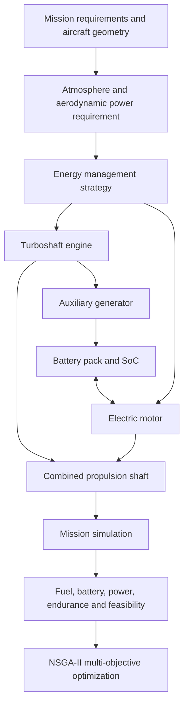

# Hybrid-Electric UAV Propulsion Optimization Using NSGA-II

**MATLAB-based conceptual design, mission simulation, and multi-objective optimization of a parallel-hybrid fixed-wing UAV.**

This repository develops a simplified system-level model for **Problem Statement 1: Hybrid-Electric Propulsion Optimization for a Fixed-Wing UAV**, issued by **IIT Indore in collaboration with Hindustan Aeronautics Limited (HAL)**. The model estimates aerodynamic power requirements, distributes shaft power between a turboshaft and an electric motor, tracks battery state of charge (SoC) and fuel consumption, and explores design trade-offs using a MATLAB **NSGA-II-style multi-objective genetic algorithm (`gamultiobj`)**.

> **Project status:** Research/educational simulation, **not a validated aircraft design or flight-certified system**. Numerical outcomes depend on assumed engine performance, component efficiencies, OEW, and mission conditions. Run the checks and report actual MATLAB outputs before publishing performance claims.

## Project highlights

- Fixed-wing UAV mission: takeoff, climb, cruise, descent to loiter altitude, loiter, and final descent.
- ISA atmosphere and parabolic drag polar to calculate required shaft power.
- Parallel-hybrid architecture with turbine shaft power, motor shaft assistance, generator charging losses, and battery SoC tracking.
- **Installed-power degree of hybridization (DoH)** used to size the electric motor relative to the turbine.
- Cruise charging governed by a selectable SoC target and maximum DC charging power.
- Electric assistance during loiter, subject to motor/pack power and SoC limits.
- **Three-objective NSGA-II optimization:** maximize endurance, minimize fuel for a common comparison mission, and minimize battery mass.
- Power/energy feasibility checks, six-panel dashboard, diagnostics, and a power-management comparison script.

## Model architecture



**Power conventions:** `P_turb` and `Pmotor` are shaft powers (W); `Pbatt` is DC battery power (W), **positive for discharge** and **negative for charging**. Motor and generator losses are modelled explicitly. These quantities should **not** be summed without accounting for their conversion paths.

## Baseline assumptions

Values are taken from `MATLAB/assumptions.m`, rather than inferred from screenshots.

| Quantity | Baseline | Notes |
|---|---:|---|
| Maximum takeoff mass | 1,000 kg | Constraint |
| Payload | 200 kg | Fixed mission requirement |
| Reference operating empty weight | 550 kg | Assumes reference motor/generator included; battery and fuel excluded |
| Turbine available power | **65 kW at 9 km** | **Unverified design/sensitivity assumption**, not a confirmed PBS TP100 altitude rating |
| Wing area / aspect ratio | 16 m² / 25 | Conceptual sizing |
| Parasite drag coefficient / Oswald factor | 0.030 / 0.75 | Assumptions |
| Propeller efficiency | 0.80 | Constant approximation |
| Cruise altitude / airspeed | 9,000 m / 69.4 m/s | Approx. 250 km/h |
| Climb rate | 2.5 m/s | Fixed, not optimized |
| Loiter altitude / duration | 3,000 m / 120 min | Fixed, not optimized |
| Battery specific energy | 260 Wh/kg | Fixed technology during optimization |
| Battery power density | 0.50 kW/kg | Common limit assumed for charge and discharge |
| Motor / generator efficiency | 0.92 / 0.95 | Constant approximations |
| Initial / hard-reserve SoC | 100% / 15% | Reserve enforced during mission |
| Minimum final SoC | 20% | **Experimental study constraint**, not stipulated numerically by HAL |

The actual motor rating, effective OEW, fuel mass, battery capacity, and mission endurance depend on the candidate design. For example, changing DoH changes motor rating and applies **only an incremental motor-mass adjustment** to the 550 kg reference OEW, to avoid counting the installed reference motor twice.

## Repository layout

```text
HAL_Hybrid_UAV_NSGA2/
├── README.md                           # GitHub project overview and run instructions
├── .gitignore                          # Ignore MATLAB temporary/generated artifacts
├── MATLAB/
│   ├── main.m                          # Reference configuration and dashboard
│   ├── optimizer.m                     # NSGA-II Pareto search using gamultiobj
│   ├── test_project.m                  # Physics and integration assertions
│   ├── compare_pms.m                   # Turbine-only vs electric-assisted loiter
│   ├── assumptions.m                   # Fixed aircraft/mission/model assumptions
│   ├── configure_design.m              # Map optimization variables to design
│   ├── evaluate_design.m               # Feasibility, fuel budget, endurance search
│   ├── mission_profile.m               # Continuous six-phase altitude profile
│   ├── mission_sim.m                   # Time-step mission integration
│   ├── power_required.m                # Aerodynamic shaft power demand
│   ├── atmosphere_model.m              # Simplified ISA atmosphere
│   ├── power_split.m                   # Energy management and shaft balance
│   ├── engine_model.m                  # Approximate part-load fuel flow
│   ├── motor_model.m                   # Motor shaft/DC conversion
│   ├── battery_model.m                 # State of charge integration
│   ├── dashboard.m                     # Dashboard and additional plots
│   └── CONTENTS.m                      # Short file descriptions
├── Documentation/
│   ├── MODEL_AND_ASSUMPTIONS.md         # Methods, equations and limitations
│   ├── OPTIMIZATION_AND_RESULTS.md     # NSGA-II objectives, bounds and interpretation
│   ├── GETTING_STARTED.md              # Practical run and troubleshooting guide
│   ├── VALIDATION_CHECKLIST.md         # Checks to run before reporting results
│   └── HAL_UAV_NSGA2_Model_Guide.docx   # Longer technical write-up
└── Original_Inputs/                    # Archived initial MATLAB files for comparison
```

**Run the `MATLAB` files, not those in `Original_Inputs`.** The archived inputs are not part of the runnable revised framework.

## Requirements

- MATLAB with support for the functions used in the project (including `yline`, `sgtitle`, `array2table`, and `writetable`).
- **Global Optimization Toolbox** to run `optimizer.m` (`gamultiobj`).
- The base simulation (`main.m`), regression tests (`test_project.m`), and strategy comparison (`compare_pms.m`) do **not** call `gamultiobj`.

A specific minimum MATLAB release has **not** been verified against this codebase. If publishing a reproduced run, record your MATLAB release, OS, toolbox version, and the exact commit used.

## Quick start

1. Clone or download this repository.
2. Open MATLAB and set the **Current Folder** to the repository's `MATLAB/` directory.
3. In the MATLAB Command Window, run the following **one at a time**:

```matlab
test_project       % checks essential physics, power balance and mission feasibility
main               % runs the fixed reference design and opens plots
compare_pms        % compares electric loiter assist vs turbine-only loiter
optimizer          % runs NSGA-II (Global Optimization Toolbox required)
```

The reference run uses the design vector:

```matlab
% [DoH, battery mass (kg), charge-target SoC, max charge (kW), loiter assist fraction]
x = [0.38, 75, 0.65, 8, 0.45];
```

**Important:** this is a demonstration input, **not** an optimized answer. See [Getting started](Documentation/GETTING_STARTED.md) for detailed instructions and troubleshooting.

## NSGA-II optimization

`MATLAB/optimizer.m` uses MATLAB's `gamultiobj` (a controlled elitist genetic algorithm in the NSGA-II family) with five design variables:

| Variable | Range | Interpretation |
|---|---:|---|
| Installed-power DoH | 0.30–0.55 | Motor shaft rating relative to combined installed turbine + motor shaft ratings |
| Battery mass | 60–120 kg | Sets energy capacity, battery power capability and mass available for fuel |
| Charge-target SoC | 20–85% | Stops cruise charging at this selected SoC |
| Maximum charging power | 2–10 kW DC | Limited also by generator, pack and available turbine shaft power |
| Loiter electric assist request | 0–85% | Requested fraction of loiter shaft demand supplied electrically, subject to limits |

The turbine's **65 kW assumption**, climb rate, cruise conditions, and 120-minute loiter remain fixed in this optimization. Battery specific energy is **not** a free design variable: it remains 260 Wh/kg unless a separate battery-technology scenario is conducted.

### Three objectives, two mission evaluations

The optimization **minimizes**:

1. **Negative maximum endurance, hours:** longer feasible mission is better.
2. **Fuel burned on a fixed comparison mission, kg:** 2-hour cruise and 2-hour loiter for every candidate, allowing apples-to-apples fuel comparisons.
3. **Battery mass, kg:** lighter battery is better, provided mission constraints are satisfied.

Maximum endurance is computed separately by extending cruise until the available fuel budget or another feasibility constraint is reached. These two evaluations are intentionally different; **fuel use for a longer optimized mission must not be compared directly with fuel for a fixed-duration mission**.

`optimizer.m` selects a **representative balanced Pareto point** based on normalized objective distance; it does not find a single universally best solution.

### Feasibility checks

Candidates are checked for turbine shaft rating, motor rating, DC pack power, delivered propulsion power, battery hard reserve, the 20% terminal SoC study requirement, max takeoff mass, fuel budget, and `CLmax`. See [Optimization and results](Documentation/OPTIMIZATION_AND_RESULTS.md).

## Visualizations and outputs

`main` and the selected optimized design produce:

- Six-panel dashboard: altitude, turbine/battery power, SoC, cumulative fuel, mass breakdown, and design summary.
- Power-management diagnostics: engine load, electric motor shaft power, operating DoH, and DC charging power.
- Battery energy and C-rate plots.

`optimizer` additionally produces Pareto scatter plots and writes these files to the MATLAB Current Folder:

| Output | Description |
|---|---|
| `NSGA2_Pareto_Results.csv` | Feasible candidate design variables and objectives |
| `NSGA2_Results.mat` | Pareto set, objective values and selected candidate |

`compare_pms` displays a two-strategy comparison using otherwise identical design variables. For publication-quality plots, export MATLAB figures **after confirming their data are physically and numerically sound**.

## Interpreting the battery and hybridization plots

- **Stored energy:** `SoC × physical battery capacity`; this is not energy consumed.
- **Discharge (`Pbatt > 0`):** battery DC energy supplies the electric motor, with motor efficiency loss.
- **Charge (`Pbatt < 0`):** some turbine shaft power feeds an auxiliary generator; generator and battery charging efficiencies reduce stored energy.
- **Installed DoH:** the ratio of installed motor shaft rating to turbine-plus-motor installed shaft ratings.
- **Operating DoH:** the time-varying ratio of motor shaft assist to turbine-plus-motor propulsive shaft output. It can differ from installed DoH.
- **Final SoC:** a minimum 20% landing requirement is enforced; reaching exactly 20% is **not** necessary to be optimal.

## Validation and known limitations

The source code includes static/integration assertions but the updated package has **not been independently confirmed running in a MATLAB installation with Global Optimization Toolbox**. Before reporting conclusions, run `test_project`, `main`, `compare_pms` and `optimizer` and retain their outputs. The reference example does **not** establish that the full search will converge to an empirically validated global optimum.

Known simplifications include constant-weight aerodynamic calculations at MTOW; assumed engine lapse and part-load SFC; constant propulsion component efficiencies; simplified descent power; an assumed auxiliary generator; battery power-density and charge/discharge efficiencies; and approximate motor-mass scaling within OEW. The model does not represent a verified TP100 altitude map, thermal limits, propeller/gearbox performance maps, full electrical dynamics, detailed structural design, or certification requirements.

See [Model and assumptions](Documentation/MODEL_AND_ASSUMPTIONS.md) and [Validation checklist](Documentation/VALIDATION_CHECKLIST.md).

## Background and references

- IIT Indore × HAL, *Hybrid-Electric Propulsion Optimization for a Fixed-Wing UAV* (Problem Statement 1, supplied with the project).
- Research and design assumptions compiled in the project author's HAL assumptions report; primary papers should be checked and cited in any academic submission.
- [MathWorks — `gamultiobj`](https://www.mathworks.com/help/gads/gamultiobj.html).
- [MathWorks — `gamultiobj` algorithm](https://www.mathworks.com/help/gads/gamultiobj-algorithm.html).
- [PBS TP100 manufacturer product page](https://www.pbs.cz/en/aerospace/aircraft-engines/pbs-tp100) (use for verified specifications; **do not** treat 65 kW at 9 km as confirmed by the product page).

## Contributing and licensing

Contributions should preserve unit consistency, separate study assumptions from verified manufacturer data, and include repeatable test cases. Please do not publish performance claims without the corresponding MATLAB version, parameter set, plots, and feasibility checks.

**License:** none has been selected. Add a `LICENSE` file with terms you choose before encouraging external reuse; without one, standard copyright restrictions apply.

---

*Educational and research-use simulation only. Not engineering approval for real aircraft operations.*
